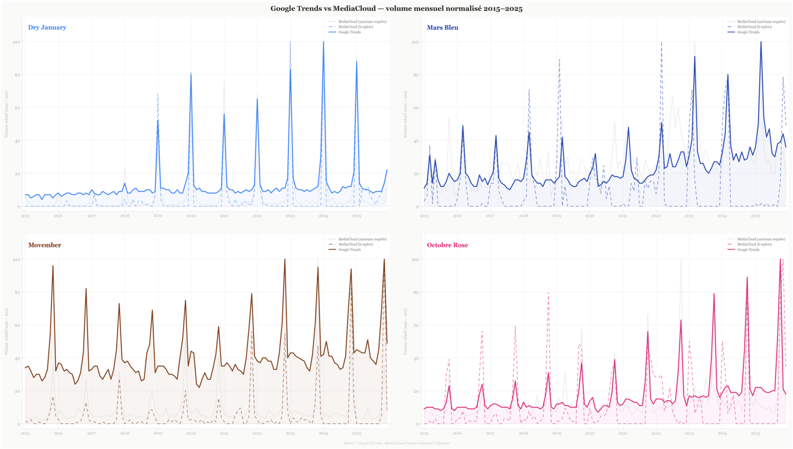
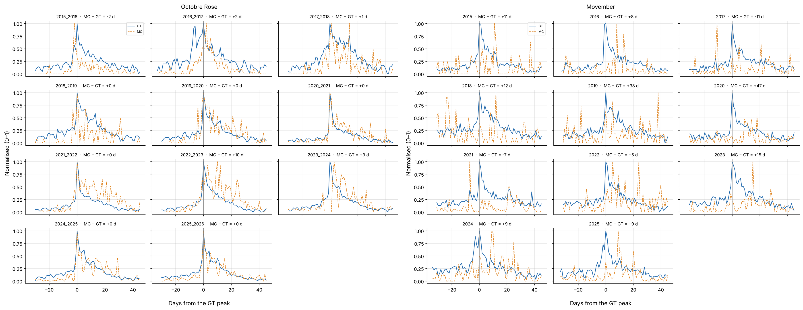
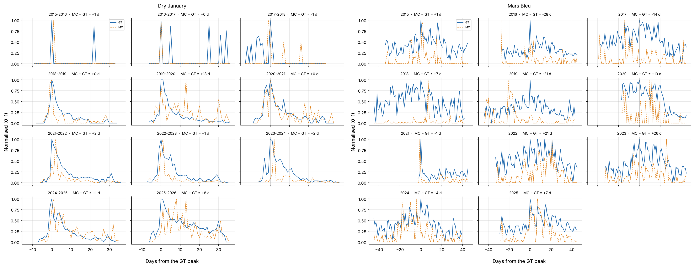
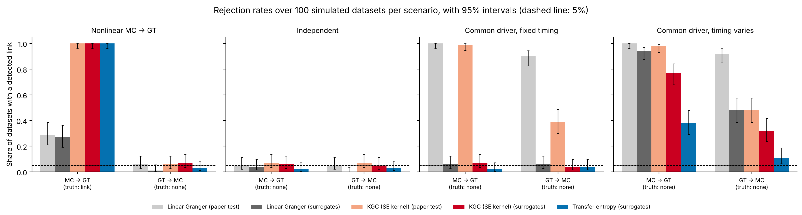
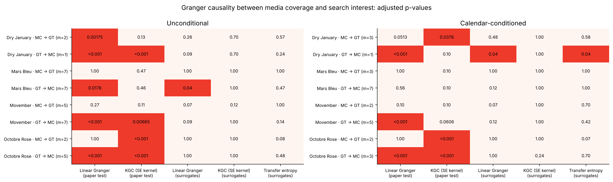
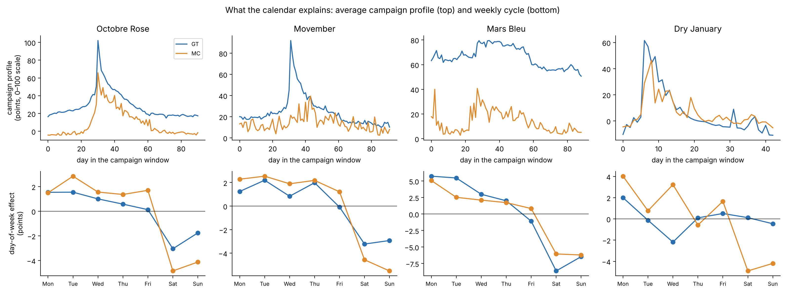

# MEDIA COVERAGE AND ONLINE SEARCH INTEREST DURING FRENCH HEALTH AWARENESS CAMPAIGNS

### Granger causality and transfer entropy beyond the campaign calendar

Timothée Roina, supervised by Marie-Laure Charpignon.

**Contents:** [Abstract](#abstract) · [Background](#background) · [Research Questions](#research-questions) · [Datasets](#datasets) · [Methods](#methods) · [Results and Discussion](#results-and-discussion) · [Conclusion and Future Work](#conclusion-and-future-work) · [Repository Guide](#repository-guide) · [References](#references) · [About](#about)

---

## Abstract

Whether media coverage and public interest follow each other during health awareness campaigns is rarely quantified. We study four recurring French campaigns (Octobre Rose, Movember, Mars Bleu, Dry January) over eleven seasons (2015–2025), combining Google Trends (GT), which measures what people search for online, with MediaCloud (MC) counts of press articles. Coverage and searches peak together for Octobre Rose and Dry January, while for Movember coverage peaks a median of nine days after searches. Because the campaign calendar and the weekly cycle drive both series, we compare linear Granger tests, kernel Granger causality and transfer entropy with the same tests run on data in which one series comes from another season. Simulations with a known truth show that the shared calendar alone produces the links that standard tests report in seven of eight campaign–direction pairs; the season-swap tests remove them, and transfer entropy, a model-free measure of predictive information, finds a purely nonlinear link in all 100 simulated datasets and is the least affected when the timing of a campaign varies from year to year. Applied to the campaigns, these tests show that the information that coverage and searches share is carried by the average campaign profile: once it is removed together with the weekly cycle and the season levels, one of 24 tests is significant. Octobre Rose, the campaign with the strongest standard tests, shows no link beyond its calendar with the linear and kernel tests, and no link is found by more than one method once the profile is removed. Any association that remains is a predictive association, not evidence of a causal effect.

Full text: [`report/main.tex`](report/main.tex) (LaTeX report) and [`report/jmir/JMIR_manuscript.docx`](report/jmir/JMIR_manuscript.docx) (manuscript formatted for JMIR Infodemiology).

## Background

Recurring awareness campaigns such as Octobre Rose (breast cancer), Movember (prostate cancer), Mars Bleu (colorectal cancer) and Dry January (alcohol) are embedded in the French public health calendar, yet their population-level effectiveness is hard to evaluate. Digital traces are a low-cost complement to surveys: infodemiology, the study of the distribution and determinants of health information in electronic media [1], has established online search data, and Google Trends in particular, as a measure of public interest in health topics [2].

Earlier studies evaluated campaigns one channel at a time and compared a campaign period with a baseline [3–5]. Studies that pair news volume with search volume report both directions [7, 8] and rely on Granger causality [9]. That test assumes that no unobserved variable drives both series. During campaigns two calendars do: the campaign calendar raises press coverage and searches on the same dates every year, and the weekly cycle lowers both at weekends. Either can make one series "predict" the other without any day-to-day link between them.

## Research Questions

1. Do media coverage and search interest peak at the same time in each campaign?
2. During health awareness campaigns, does media coverage help predict public search interest, or the reverse, beyond the calendars that drive both?
3. Do the tests find links that exist and avoid inventing links that do not? This is checked on simulated seasonal systems where the truth is known.
4. What do the links depend on: the weekly cycle, the level of each season, or the average campaign profile?

## Datasets

Daily series within a window around each campaign, 11 seasons per campaign (2015–2025), in [`data/processed/daily/`](data/processed/daily/).

| Campaign | Window | Days per season |
|---|---|---|
| Octobre Rose | 1 Sep – 30 Nov | 91 |
| Movember | 1 Oct – 31 Dec | 92 |
| Mars Bleu | 2 Feb – 30 Apr | 88–89 |
| Dry January | 26 Dec – 6 Feb | 43 |

* **Google Trends** (`GT_<code>_Granger.csv`): relative search volume (0–100) for France, retrieved with PyTrends at daily resolution, one request per season, so 100 is the busiest day of each season. The query is stored in the `query` column.
* **MediaCloud** (`MC_<code>_Granger_normalized.csv`): daily counts of articles from a collection of French national news outlets, divided by their seasonal maximum and multiplied by 100 (`n_articles`). These files do not record the query used; the terms are listed in the report appendix.

Codes: `OR` Octobre Rose, `Mov` Movember, `MB` Mars Bleu, `DJ` Dry January. Known limits: each GT window was downloaded once, both series are normalised within each season (levels are not comparable across seasons), and MediaCloud covers national online news only, not regional press, television or social media.



*Monthly GT and MC series, 2015–2025, each normalised to a maximum of 100.*

## Methods

### Peak alignment

Each season is aligned on its GT peak and the lag between the MC peak and the GT peak is read for every season.

### Linear Granger causality

Full and restricted autoregressive models compared with an F-test; lags are built inside each season (a lag across two seasons is meaningless); lag orders chosen by AIC on a common sample [13]; Holm correction across the eight campaign–direction pairs [14]; leave-one-year-out (LOYO) validation; delete-one-season jackknife intervals; ADF [15] and KPSS [16] stationarity tests.

### Accounting for the campaign calendar

* **Season-swap surrogates** [17]: the cause series of each season is replaced by that of another season (a random derangement). A surrogate keeps the cause's dynamics and campaign-shaped profile but loses its day-to-day correspondence with the effect. 199 surrogates (999 for the calendar adjustments), p = (1 + #{surrogate ≥ observed}) / (1 + n).
* **Calendar conditioning**: day in the window and day of the week added to both models.
* **Five calendar adjustments of both series**: A none; B weekly cycle removed; C season means removed; D campaign profile and weekly cycle removed, season levels kept; E all three removed (the *anomalies*).

### Nonlinear Granger causality

* **Kernel Granger causality (KGC)** [19], in the formulation reviewed by Murphy and Benavoli [18], with a squared-exponential kernel and a degree-1 polynomial kernel (equivalent to linear Granger).
* **Transfer entropy (TE)** [20]: conditional mutual information between the effect today and the past of the cause given the past of the effect. For Gaussian variables it equals linear Granger causality [21]. Estimated with the Kraskov–Stögbauer–Grassberger nearest-neighbour estimator in the Frenzel–Pompe conditional form [22, 23] (k = 5, at most 3 lags), and always compared with its value on surrogates.

### Simulations with a known truth

100 datasets per scenario (11 seasons of 91 days), 39 surrogates per test, Wilson 95% intervals: a purely nonlinear link; independent series; a common driver with fixed timing; a common driver whose timing varies by ±15 days; and four linear lagged systems to check the power of transfer entropy.

## Results and Discussion

### Temporal alignment

Peaks are synchronous for Octobre Rose and Dry January; for Movember the media peak follows the search peak; Mars Bleu shows no stable alignment.

| Campaign | Median lag (days) | Range | Seasons within ±2 days |
|---|---|---|---|
| Octobre Rose | 0 | −2 to +10 | 9/11 |
| Dry January | +1 | −1 to +13 | 9/11 |
| Movember | +9 | −11 to +47 | 0/11 |
| Mars Bleu | +1 | −28 to +26 | 2/11 |

*Positive lag = media peak after the search peak.*





### Standard linear tests

With within-season lags, past searches predict press coverage for Mars Bleu, Movember and Octobre Rose (Holm-adjusted p < 10⁻⁷, all 11 LOYO folds significant, ΔR²adj between 0.034 and 0.073) but not for Dry January (p = 0.27). In the other direction the tests are significant after correction for Dry January, Movember and Octobre Rose, with tiny gains (at most 0.022). Allowing lags to cross the boundary between seasons creates two extra links (Dry January GT → MC, Mars Bleu MC → GT).

### What simulations show

With a common driver of fixed timing and no direct link, standard tests report links in 39–100% of the datasets; season-swap surrogates in 2–7%. KGC and TE find the purely nonlinear link in 100 of 100 datasets, the linear test in 27–29. When the timing of the campaign pulse varies from year to year the surrogate tests still report links (linear 48–94%, KGC 32–77%, TE 11–38%), so a surrogate test removes a common driver with fixed timing but not one whose date changes. TE detects a strong lagged link (cumulated response 1.249) in 100 of 100 datasets but a weak one (0.300) in only 10 of 100: a null result of TE excludes strong lagged links, not weak ones.



### Links beyond the campaign calendar

Holm-adjusted p-values against season-swap surrogates (199 surrogates, eight tests per column). Lin.: linear Granger; KGC: squared-exponential kernel; TE: transfer entropy. Bold: p < 0.05.

| Campaign | Direction | Lin. | KGC | TE | Lin. (conditioned) | KGC (conditioned) | TE (conditioned) |
|---|---|---|---|---|---|---|---|
| Dry January | GT → MC | 0.090 | 0.70 | 0.24 | **0.040** | 1.00 | **0.040** |
| | MC → GT | 0.26 | 0.70 | 0.57 | 0.48 | 1.00 | 0.58 |
| Mars Bleu | GT → MC | **0.040** | 1.00 | 0.47 | 0.12 | 1.00 | 1.00 |
| | MC → GT | 1.00 | 1.00 | 1.00 | 1.00 | 1.00 | 1.00 |
| Movember | GT → MC | 0.090 | 1.00 | 0.14 | 0.12 | 1.00 | 0.42 |
| | MC → GT | 0.070 | 0.12 | 1.00 | 0.070 | 1.00 | 0.70 |
| Octobre Rose | GT → MC | 1.00 | 1.00 | 0.48 | 1.00 | 0.24 | 0.70 |
| | MC → GT | 1.00 | 1.00 | 0.080 | 1.00 | 1.00 | 0.070 |

Almost nothing survives. Without calendar conditioning only the linear test for Mars Bleu GT → MC is significant; with it, only Dry January GT → MC, for the linear test and for TE (0.040 each). That Dry January signal is the one that two methods with different assumptions share, but the window holds only 43 days per season, TE does not find it without conditioning (0.24), and it vanishes with the whole calendar removed (0.60 and 0.88). Mars Bleu GT → MC is not robust: it is significant for the linear test without adjustment (0.008) and for KGC with everything removed (0.040), but for none of the three methods with the weekly cycle removed. With everything removed, one of 24 tests is significant (KGC, Mars Bleu, GT → MC, p = 0.040), which the linear test (0.62) and TE (0.91) do not reproduce. **Octobre Rose** shows no link beyond its calendar with the linear and kernel tests: the real search series explains no more of press coverage than search series from other years (KGC δ = 0.312 against 0.325 on average for surrogates), which fits a fixed date (1 October) driving both series. For Movember, TE does not support a link from coverage to searches (p = 0.75).



### What the calendar explains

The campaign profile (one value per calendar date, averaged over seasons) carries 74% and 84% of the variance of the GT series of Octobre Rose and Movember and 60% of the MC series of Octobre Rose, but only 15% of the MC series of Movember and 22–23% of both series of Mars Bleu; the weekly cycle carries at most 9%.



### Discussion

Most of the coupling reflects the campaign calendar. Octobre Rose is the clearest case: its peaks coincide, its standard tests are highly significant, yet its day-to-day coverage carries almost no information about searches beyond what any year's coverage would. These are predictive associations beyond a fixed calendar, not evidence of a causal effect; events whose date changes from year to year (news, announcements) are not removed by any of the tests, although TE is the least affected. Limits: 11 seasons per campaign; KPSS indicates a non-constant mean for four of the eight series; many specifications were run and corrections apply within each family of eight tests only; TE uses at most three lags and has little power against weak links; GT windows were downloaded once; the Dry January window has only 43 days.

## Conclusion and Future Work

Most of the apparent coupling between media coverage and public interest during French health campaigns reflects their shared calendar, and in particular the average campaign profile. We find no evidence of a day-to-day link between coverage and searches beyond that calendar; with 11 seasons per campaign, and given the low power of transfer entropy against weak links, weak links are not excluded.

Future work: (i) use media shocks unrelated to the campaign calendar (news events, celebrity announcements); (ii) hourly search data and time-stamped articles to resolve the order of events within a day; (iii) relate the campaign profile to season-level features (size and timing); (iv) event-study designs against control topics without a campaign; (v) link search interest to downstream outcomes such as screening uptake.

## Repository Guide

```
├── README.md                this file
├── LICENSE                  MIT
├── figures_tables/          figures embedded in this README
├── references/              numbered reference list (JMIR format)
├── report/
│   ├── main.tex             LaTeX report (compile with pdflatex), figures in report/figures/
│   └── jmir/                JMIR Word manuscript, Multimedia Appendix 1, figure files for upload, build scripts
├── notebooks/               analysis notebooks (table below)
├── src/phc/                 shared code
├── tests/                   unit tests (pytest)
├── data/processed/daily/    daily GT and MC series used in the analysis
└── results/                 tables (CSV), figures and cache
```

### Notebooks

| Notebook | Content | Runs offline |
|---|---|---|
| [`01_query_building_and_data_collection`](notebooks/01_query_building_and_data_collection.ipynb) | GT snowball query discovery, MC article texts and k-grams, monthly series, daily campaign windows | no (APIs) |
| [`02_visualisation_and_peak_timing`](notebooks/02_visualisation_and_peak_timing.ipynb) | Daily windows, seasons aligned on the GT peak, lag between MC and GT peaks | yes |
| [`03_granger_analysis`](notebooks/03_granger_analysis.ipynb) | Linear Granger causality with within-season lags: AIC, F-tests, LOYO, coefficients, jackknife, impulse responses, sensitivity, season fixed effects | yes |
| [`04_nonlinear_kernel_granger`](notebooks/04_nonlinear_kernel_granger.ipynb) | KGC and transfer entropy, season-swap surrogates, simulations, five calendar adjustments, power of TE, robustness to the number of neighbours | yes* |
| [`05_report_figures`](notebooks/05_report_figures.ipynb) | Monthly GT vs MC series, snowball rounds, top k-grams | needs files from notebook 01 |
| [`06_calendar_components`](notebooks/06_calendar_components.ipynb) | Campaign profile, weekly cycle and season level: share of the variance, figure | yes |

\* A full run takes about 6 hours on two cores. Results are cached in `results/cache/kernel_granger.joblib`, so the notebook reopens in seconds; set `RECOMPUTE = True` to recompute everything.

Shared code in `src/phc/`: `config.py` (paths, campaigns, windows, queries), `collect.py` (GT and MC collection, k-grams), `granger.py` (lag matrices, AIC, F-test, LOYO, stationarity, impulse responses), `kernel_granger.py` (KGC, surrogates, jackknife), `transfer_entropy.py` (KSG / Frenzel–Pompe estimator), `seasonal.py` (calendar components), `simulate.py` (simulated systems).

### Getting started

```bash
git clone https://github.com/timothee-roi/publichealth-campaigns-datascience
cd publichealth-campaigns-datascience
python -m venv .venv && source .venv/bin/activate
pip install -r requirements.txt
jupyter lab notebooks/
```

Notebooks 02, 03, 04 and 06 run on the included data. For notebook 01, get a MediaCloud API key at <https://search.mediacloud.org> and set `MEDIACLOUD_API_KEY` before starting Jupyter. Google Trends is accessed with `pytrends`, an unofficial client that Google rate-limits heavily, so collection is slow. Run the tests with `pytest`.

### Rebuilding the JMIR manuscript

```bash
cd report/jmir && ./make.sh      # needs pandoc, python-docx and pillow
```

This regenerates `JMIR_manuscript.docx`, `JMIR_Multimedia_Appendix_1.docx` and `figures_upload/` from `report/main.tex`. The sections follow the JMIR instructions for authors (structured abstract, Introduction / Methods / Results / Discussion with Principal Results, Limitations, Comparison With Prior Work and Conclusions, numbered references).

## References

Full list with DOIs in [`references/references.md`](references/references.md).

1. Eysenbach G. Infodemiology and infoveillance: framework for an emerging set of public health informatics methods to analyze search, communication and publication behavior on the Internet. J Med Internet Res 2009;11(1):e11
2. Nuti SV, Wayda B, Ranasinghe I, et al. The use of Google Trends in health care research: a systematic review. PLoS One 2014;9(10):e109583
3. Glynn RW, Kelly JC, Coffey N, Sweeney KJ, Kerin MJ. The effect of breast cancer awareness month on internet search activity. BMC Cancer 2011;11:442
4. González-Padilla DA, España-Navarro R, Subiela JD, et al. Is "Movember" an effective prostate cancer awareness campaign beyond the English language? Soc Int Urol J 2021;2(6):362-369
5. Ayers JW, Westmaas JL, Leas EC, et al. Leveraging big data to improve health awareness campaigns: a novel evaluation of the Great American Smokeout. JMIR Public Health Surveill 2016;2(1):e16
6. McCombs ME, Shaw DL. The agenda-setting function of mass media. Public Opin Q 1972;36(2):176-187
7. Weeks B, Southwell B. The symbiosis of news coverage and aggregate online search behavior. Mass Commun Soc 2010;13(4):341-360
8. Kwak H, An J, Salminen J, Jung SG, Jansen BJ. What we read, what we search: media attention and public attention among 193 countries. Proceedings of the 2018 World Wide Web Conference
9. Granger CWJ. Investigating causal relations by econometric models and cross-spectral methods. Econometrica 1969;37(3):424-438
10. Roberts H, et al. Media Cloud: massive open source collection of global news on the open web. Proc Int AAAI Conf Web Soc Media 2021;15(1)
11. Mavragani A, Ochoa G. Google Trends in infodemiology and infoveillance: methodology framework. JMIR Public Health Surveill 2019;5(2):e13439
13. Akaike H. A new look at the statistical model identification. IEEE Trans Automat Contr 1974;19(6):716-723
14. Holm S. A simple sequentially rejective multiple test procedure. Scand J Stat 1979;6(2):65-70
15. Dickey DA, Fuller WA. Distribution of the estimators for autoregressive time series with a unit root. J Am Stat Assoc 1979;74(366):427-431
16. Kwiatkowski D, Phillips PCB, Schmidt P, Shin Y. Testing the null hypothesis of stationarity against the alternative of a unit root. J Econom 1992;54(1-3):159-178
17. Theiler J, Eubank S, Longtin A, Galdrikian B, Farmer JD. Testing for nonlinearity in time series: the method of surrogate data. Physica D 1992;58(1-4):77-94
18. Murphy F, Benavoli A. Constraint- and score-based nonlinear Granger causality discovery with kernels. arXiv 2026 (preprint)
19. Marinazzo D, Pellicoro M, Stramaglia S. Kernel method for nonlinear Granger causality. Phys Rev Lett 2008;100(14):144103
20. Schreiber T. Measuring information transfer. Phys Rev Lett 2000;85(2):461-464
21. Barnett L, Barrett AB, Seth AK. Granger causality and transfer entropy are equivalent for Gaussian variables. Phys Rev Lett 2009;103(23):238701
22. Kraskov A, Stögbauer H, Grassberger P. Estimating mutual information. Phys Rev E 2004;69(6):066138
23. Frenzel S, Pompe B. Partial mutual information for coupling analysis of multivariate time series. Phys Rev Lett 2007;99(20):204101

(Reference 12 of the manuscript, this repository, is omitted here.)

## About

Project by **Timothée Roina**, supervised by **Marie-Laure Charpignon**. Code under the [MIT licence](LICENSE). If you use this work, see [`CITATION.cff`](CITATION.cff).

Predictive associations only: nothing here estimates the effect of a campaign on health outcomes.
